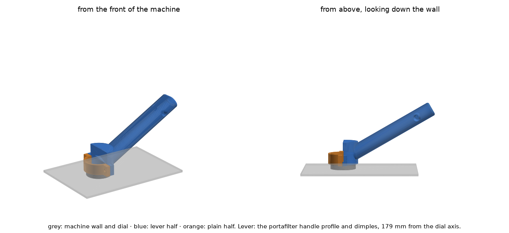

# Hot water dial lever (Breville BES920)

A two-piece collar that clamps over the machine's smooth hot water dial, with a lever the
claws grip end-on, like the portafilter handle. The coffee service's `open_hot_water` action
turns the lever 37.5° counter-clockwise (seen from the left of the machine) to open the
valve, and `close_hot_water` turns it back.



## Design notes

- **No changes to the machine.** The dial doesn't come off, so the collar squeezes it like a
  shaft collar on a smooth shaft: two M3 screws pull the halves together. If it slips, put a
  strip of rubber (bicycle inner tube) or a printed TPU liner inside the bore.
- **The lever copies the portafilter handle.** The same profile (36.7 x 24 mm, rounded ends
  facing the turn) and the same conical dimple in each rounded end, sized from the handle's
  STL, so the cone-shaped peg on each finger locks in as it does on the handle. The fingers
  push the lever around through the pegs, not by friction. On the robot the printed lever is
  slightly too wide for the claws: the grip holds, but narrow `LEVER_WIDTH` in a reprint.
- **Tilted ~30° out from the wall.** With a lever flat against the dial, the gripper lines up
  with the arm's forearm mid-turn (a wrist singularity) and the arm can't turn it smoothly.
  The tilt keeps the wrist at least 45° away from that. Measured on the robot: 33°.
- **Where the claws sit.** The model puts `grip-point` 95 mm along the lever, but on the robot
  the claws grip best with `grip-point` 72 mm from the dial axis (taught by jogging, then
  confirmed by two turns). The coffee service uses the taught grip, not the model's.
- **Mounting angle.** Clamp it with the valve closed and the lever pointing toward the front
  of the machine, about level (on Cappuccina it sits 2.5° below horizontal). The valve hisses
  at ~15° of turn, drips at ~18° and pours a full stream from ~33°; its full travel is 90°.
  Mounted level, the lever stays out of the arm's way in and out of the group head.

## Files

- `knob.py`: the parametric model ([build123d](https://build123d.readthedocs.io)). Every
  dimension is a named constant at the top.
- `out/half_a_lever.stl`, `out/half_b.stl`: the two halves to print.
- `out/half_a_test.stl`, `out/ring_a.stl`, `out/ring_b.stl`: fit tests. Print one with
  `half_b.stl` (or the two rings) to check the fit and grip before the full part.
- `out/knob_assembly.step`: both halves, for CAD tools (Onshape, Fusion) if anyone wants to
  edit by hand.
- `dialsim/`: a program that drives the arm to and around the lever step by step, for finding
  the grip and checking the turn before the coffee service does it. See below.

## Regenerating

```bash
uv venv -p 3.12 .venv && VIRTUAL_ENV=.venv uv pip install build123d
.venv/bin/python knob.py
```

## Printing

- Material: Onyx (Markforged) or PETG, not PLA: the machine gets warm enough to soften PLA.
  PLA is fine for the fit test (Cappuccina's current lever is PLA).
- Orientation: `half_b` and `half_a_test` with the open end of the collar (the flat face with
  the bore) on the bed. `half_a_lever` on its flat split face, so the lever leans up and needs
  no supports.
- 4 walls, 15–20% infill, 0.2 mm layers.
- Hardware: two M3 x 16 mm socket head screws and two M3 nuts (the nuts press into the hex
  traps on half A).

## Fitting

1. Print a fit test, put it around the dial, and tighten both screws. Twist it by hand: it
   should turn the dial without slipping. Too tight to close around the dial: raise
   `BORE_CLEARANCE` by 0.2. Slips with the halves touching: lower it, or add a liner.
2. Print `half_a_lever.stl`, close the valve, and clamp the collar with the lever pointing
   forward, about level, and leaning away from the machine.

## Robot config

The lever and collar are obstacles in the machine config (`erh:vmodutils:obstacle`
components `hot-water-lever` and `hot-water-collar`), fitted to the arm camera's point cloud.
`hot-water-lever`'s frame origin sits on the dial axis with its local Z along the axis (world
+Y on Cappuccina, the direction that opens the valve), and the box is offset from it inside
the geometry: the coffee service turns the lever about that origin. The coffee service also
needs `hot_water_lever_grip_relative_pose` (the taught grip, in the lever's frame) and a
`hot_water_approach` pose on the claws switch; see the main README.

## `dialsim`

Every mode connects to the machine and waits for Enter before each move. Keep a hand on the
e-stop. Credentials come from `--api-key` / `--api-key-id` or `VIAM_API_KEY` /
`VIAM_API_KEY_ID`.

- No mode flag: a dry run of the turn 85 mm out along the dial axis from the real lever, so
  nothing is touched (`--offset`). It refuses any move that would bring the arm's flange
  within 150 mm of the counter.
- `--teach N`: one move to the lever's line, N mm beyond the grip.
- `--jog`: nudge the claws in straight lines along, across and up/down from the lever, with
  contact with the lever and collar allowed (arm jogging refuses it near the machine while
  the model still has a portafilter in the claws).
- `--grab`: open the gripper beyond the lever's tip, slide on and close.
- `--turn`: with the claws closed on the lever (anywhere along it), turn it open and back
  closed in `--step-deg` steps.

Check it offline first, against a saved move plan with the portafilter in the claws (e.g. a
`prepare_portafilter` move):

```bash
DIALSIM_PLAN=<saved plan .json> go test ./hardware/hot-water-knob/dialsim -run TestStepsPlanOffline -v
```

`DIALSIM_OFFSET=0` plans the real grab and turn instead, with the claws allowed to touch the
lever.

On the robot:

1. Send `cancel` to the coffee service (with nothing running, this only pauses the queue and
   the keepalive purge).
2. Take the portafilter out of the claws (the model still has it, so the moves let it overlap
   the machine) and put the arm at `home`: from elsewhere, the free approach can land on a
   flipped wrist that can't follow the arc.
3. Run it from the repo root:

   ```bash
   go run ./hardware/hot-water-knob/dialsim --address <machine address> [--grab | --turn | ...]
   ```

4. Afterwards, open the gripper, back out with `--jog`, send the filter pose switch to `home`,
   put the portafilter back, and send `proceed`.
